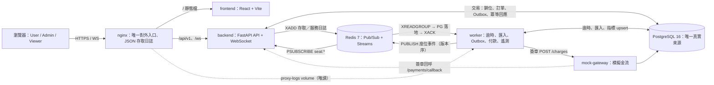

# 系統架構圖

圖檔：[architecture.svg](architecture.svg)（可直接在瀏覽器或 GitHub 檢視）。以下為同一張圖的 Mermaid 來源，方便修改。

## 元件責任

| 服務 | 責任 |
| --- | --- |
| nginx | 對外 8080；反向代理 API、WebSocket、Swagger；寫入含 request_id 的 JSON 存取日誌供 worker 關聯 |
| frontend | 購票、活動管理、匯入進度、即時座位圖、Admin 監控／告警／使用者管理／request_id 查詢 |
| backend | 認證、活動、匯入受理、購票交易、付款與回呼、座位推送、監控中介軟體、Excel 報表 |
| worker | 鎖位逾時、匯入處理、Outbox 發布、付款工作與沖正、查帳、遙測收集、每秒指標、告警 |
| mock-gateway | 獨立程序的模擬金流：持久化 charge、延遲、重試的簽章回呼、冪等沖正 |
| postgres | 訂單、座位、付款、匯入、事件版本、Outbox、日誌與指標的唯一真實來源 |
| redis | 座位事件扇出（Pub/Sub，at-most-once）與遙測交接（Streams，PG 落地後才 XACK） |

## 關鍵資料流

1. **購票**：API 在單一 PostgreSQL 交易內依固定順序取鎖（冪等列 → 額度列 → 座位列 → 活動事件版本列），以條件式 UPDATE 保留座位，並與訂單、座位事件、Outbox、冪等回應一起提交。
2. **即時推送**：worker 依 `event_streams.current_version` 順序把 Outbox 發布到 Redis；每個 API 副本的 feed hub 訂閱後推給 WebSocket 訂閱者；客戶端只套用 `version + 1`，跳號或 `resync_required` 時重取快照，每 5 秒由伺服器核對 DB 版本。
3. **付款**：API 建立付款嘗試與 `payment_requested` Outbox；worker 以付款 ID 作冪等鍵呼叫 mock-gateway；gateway 持久化後以簽章回呼通知 API；晚到付款保持訂單終止並排程沖正；查帳工作在回呼遺失時收斂。
4. **監控**：API 中介軟體量測處理延遲並送入 Redis Streams（Redis 不可用時落地 spool）；worker 批次寫入 PostgreSQL 後才 XACK，依 event_id 去重；每秒重算各來源桶，跨副本以合併樣本計算 p50/p95/p99；告警依門檻與持續時間判定並保留歷史。
