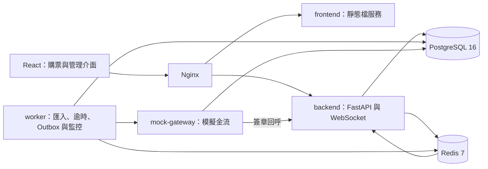
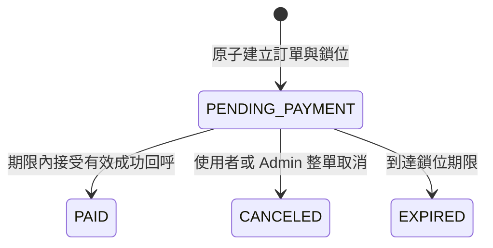

# MVP 實作設計草案

狀態：Q1–Q18 領域決策已確認；本文件與 `core-schema.md`、`acceptance-plan.md` 是實作前最後審閱的具體工程草案，尚未建立資料庫或程式碼。

需求優先序：`../goal.md` 是最終驗收依據；`../project_01.md` 是分期開發起點；已確認的澄清見 `design-interview.md`。11/18 的 MVP 里程碑與完整效能、故障驗收分開記錄，未完成項目不得宣稱通過。

## 1. 執行架構與模組邊界

沿用 FastAPI、SQLAlchemy 2、Alembic、PostgreSQL 16、Redis 7、React/Vite/TypeScript、Tailwind、Recharts、OpenPyXL、Pytest 與 Locust。應用程式採模組化單體，API 與 worker 共用領域服務；模擬金流使用獨立程序與 HTTP 回呼。

Compose 啟動七個服務：`nginx`、`frontend`、`backend`、`worker`、`mock-gateway`、`postgres`、`redis`。比原計畫增加獨立模擬金流，以實際測試跨程序回呼與故障恢復；外部入口只有 Nginx，金流控制介面留在內部網路。PostgreSQL、Redis、匯入檔案與診斷暫存使用持久化 volume。

| 模組 | 對外責任 |
| --- | --- |
| Auth | 註冊、登入、撤銷 session、查驗目前角色與啟用狀態 |
| Events | 活動建立、版本化修改、發布、刪除及固定清單分頁 |
| Imports | 受理檔案、去重、工作狀態、驗證與原 job 重試 |
| Booking | 指定座位或區域配位、購票額度、原子建立訂單 |
| Orders | 訂單讀取、未付款整單取消、逾時狀態收斂 |
| Payments | 付款嘗試、回呼、查帳與晚到／額外收款沖正 |
| Seat feed | 一致快照、活動版本、WebSocket 訂閱與失同步復原 |
| Observability | request_id、存取與服務日誌、每秒指標、告警 |
| Reports | 三工作表 Excel、批次讀取、低記憶體輸出 |

交易服務只透過自己的入口改變訂單與座位；API、worker 與 callback 不各自複製交易邏輯。資料表與約束見 `core-schema.md`。

## 2. 認證與授權

- 使用不可預測的 opaque bearer token；資料庫只存 token 雜湊。密碼使用 Argon2id 雜湊；公開註冊固定為 User，不能自行指定角色。
- Session 保存建立時的 `auth_version`。每次 HTTP 請求直接查詢 PostgreSQL 中 session、使用者啟用狀態、角色及目前 `auth_version`，第一版不使用正向權限快取。
- 登出撤銷目前 session；停用或修改角色遞增使用者 `auth_version`，讓所有舊 session 在後續驗證立即失敗。撤銷提交前已授權並開始執行的操作視為在途操作，不宣稱能收回已傳出的資料。
- WebSocket 升級後須在應用層握手的第一則訊息送出 token，驗證前不加入訂閱，token 不放在 URL。握手與控制訊息查驗 session；發送資料前批次查驗接收者資格，靜默連線至少每 5 秒重新查驗。憑證撤銷後不得通過新的認證，已送出的 frame 無法撤回。
- 活動、座位、訂單及報表的業務端點需登入；註冊、登入、健康檢查與 API 文件例外。金流回呼使用獨立服務簽章驗證。

| 操作 | Admin | User | Viewer |
| --- | --- | --- | --- |
| 瀏覽已發布活動／座位 | 可 | 可 | 可 |
| 查看草稿 | 全部 | 自己建立 | 不可 |
| 建立活動 | 可 | 可 | 不可 |
| 修改、刪除、匯入、發布 | 全部活動 | 自己建立的活動 | 不可 |
| 鎖位與付款 | 可，仍受每帳號限購約束 | 可 | 不可 |
| 查看及取消未付款訂單 | 全部 | 自己的訂單 | 不可 |
| 銷售報表 | 全部 | 自己建立的活動 | 全部活動 |
| 使用者管理、監控、告警、日誌 | 可 | 不可 | 不可 |

報表訂單明細預設包含訂單編號、時間、狀態、張數及金額，不輸出登入憑證、密碼雜湊或金流秘密。座位推送不包含購票者個資。

## 3. 狀態與計價

- 付款失敗只改變該次付款嘗試，訂單保持待付款直到取消或逾時。
- 訂單保留 5 分鐘，以 `now >= expires_at` 判定逾時。期限判斷在取得必要鎖後重新讀取資料庫 `clock_timestamp()`；不使用交易開始時固定的 `now()` 代替當下時間。
- 售票條件為 `deleted_at IS NULL`、已發布且 `sales_start <= db_now < sales_end`。既有訂單付款不再受 `sales_end` 截斷，但仍受自己的 `expires_at` 限制。
- 票價為 TWD 整數元；服務費對整筆小計計算一次，使用整數算式 `(subtotal * 5 + 50) / 100` 取整數商；總額為小計加服務費。
- 訂單明細保存當時的區域與座位標示、單價。畫面及 Excel 使用 Asia/Taipei；資料庫使用 TIMESTAMPTZ，輸入時間必須帶時區。

座位持久狀態為 AVAILABLE、HELD、SOLD。HELD 但期限已過的紀錄在業務上已不具有效保留資格；可由新訂單以受保護的條件式更新接手，舊訂單稍後收斂為 EXPIRED。任何釋放操作都限定 `current_order_id = 該訂單`，避免舊工作釋放新訂單的座位。

## 4. 購票交易、限購與冪等

同一帳號、同一活動的 `user_event_quotas` 列作為交易互斥點，額度使用權威訂單計算：PAID 張數加上未逾時 PENDING_PAYMENT 張數。第一版不以可能落後的累加計數器決定額度。

交易鎖的固定順序：冪等處理列 → 帳號／活動額度列 → 訂單列 → 付款列（若需要）→ 座位列（依 ID 排序）→ 活動事件版本列。涉及多列時使用固定排序。事件版本列取得後，不再取得前述類別的新鎖。逾時 worker 先非鎖定查出候選，再呼叫相同交易服務，不反向先鎖訂單再鎖額度。

活動管理與匯入先用 `events FOR NO KEY UPDATE` 協調，活動主鍵永不修改。軟刪除另外取得同一 `event_streams` 列的鎖，再重新確認無任何訂單與執行中匯入；購票在取得該 stream 鎖後重新讀取未刪除狀態。這讓刪除與建單共用保護，同時讓活動 metadata 鎖與外鍵所需的 key-share 鎖相容，避免改用活動 FOR UPDATE 造成交叉等待。[PostgreSQL 列鎖相容性](https://www.postgresql.org/docs/16/explicit-locking.html#LOCKING-ROWS)

指定座位購買流程：

1. 驗證身分、權限、輸入與 Idempotency-Key，建立或取得處理資格。
2. 在交易內鎖額度列，確認活動發布與售票時段，拒絕重複座位 ID、跨活動座位、張數超過 4 等請求。
3. 鎖定指定座位，再取得活動事件版本列的鎖；取得所有必要鎖後讀新的 DB 時間，重新檢查售票時段、可售狀態及有效購票額度。
4. 建立訂單與價格快照，以條件式 UPDATE 保留 AVAILABLE 或已逾時 HELD 的座位；實際更新張數必須等於請求張數。訂單為本交易新建立的列，不再取得其他既有訂單的鎖。
5. 同交易建立明細、增加活動事件版本、寫入座位事件與 Outbox，並保存冪等回應；全部一起提交。任一步失敗整筆回滾。版本列會序列化該活動的最後提交區段，須在壓測量測其等待時間。

區域配位在 PostgreSQL 內使用固定順序的候選查詢與 `FOR UPDATE SKIP LOCKED` 選取足額座位，不將候選清單讀到應用程式後自行競爭寫入。遇到暫時被其他交易鎖住的座位，回傳可重試的衝突；真正庫存不足回傳售罄／數量不足，不部分成交。

| 冪等情境 | 合約 |
| --- | --- |
| 相同使用者、操作、key 與內容，已完成 | 重播原 HTTP status/body 與原訂單，不再建立 |
| 相同 key 仍有有效處理租約 | 409 IDEMPOTENCY_IN_PROGRESS，附 Retry-After |
| 相同 key、不同正規化請求內容 | 409 IDEMPOTENCY_KEY_REUSED |
| 程序在取得資格後中止 | 租約逾期後以 generation 接手；舊處理者在交易鎖內檢查 generation |
| DB 已提交但回應遺失 | 冪等回應與訂單同交易提交，重試取得原結果 |

冪等 scope 包含使用者與操作路徑；預設至少保留 24 小時，未終結的付款不清理。租約預設 30 秒、可設定；處理中不自動延長座位保留期限。短暫 DB 錯誤整筆回滾，僅對安全可重試交易做有限次重試。

取消與逾時都沿用額度 → 訂單 → 座位 → 事件版本順序，僅 PENDING_PAYMENT 可轉為 CANCELED／EXPIRED，且只釋放仍由該訂單持有的座位。重複執行是無副作用成功；已 PAID 的取消回傳明確衝突。

## 5. 模擬金流、回呼與沖正

新增 `POST /orders/{id}/payments`：後端依訂單金額建立付款嘗試及持久化工作，worker 以付款 ID 作金流冪等 key 呼叫 mock-gateway。金流持久化結果後，以具簽章的 HTTP 回呼通知 backend；callback endpoint 不接受一般使用者 token 代替服務簽章。

- 同訂單同時最多一個尚未釐清結果的付款嘗試。使用者在確定失敗後才可重試；網路逾時先重送同一嘗試或查帳，避免當成新付款。
- 回呼檢查簽章、delivery timestamp、provider event ID、付款／訂單對應、幣別與金額。相同 event ID 不同內容拒絕；重複有效回呼回傳既有處理結果。
- 成功回呼依固定順序鎖額度、訂單、付款、座位與活動事件版本列，再讀 DB 時間。期限內且座位仍屬於該訂單，才同交易更新 PAID、SOLD、成交明細、事件及回呼處理紀錄。
- 訂單取消或逾時後收到成功，記錄 REVERSAL_PENDING 並同交易寫入沖正工作，訂單保持終止。若金流異常產生額外成功收款，也只接受一筆、沖正額外收款。
- 沖正以 provider charge ID 作冪等鍵；金流已沖正但 backend 尚未確認時重試取得同結果。失敗按退避策略重試並顯示告警，不把未完成沖正標記為完成。
- provider 已收款但 callback 未送達時，由 durable callback 重試與定期查帳收斂。預設每 5 秒掃描待處理工作，實際恢復時間需故障測試量測，不保證依賴服務停機期間仍在固定時間完成。

## 6. 座位匯入、發布與活動清單

- 檔案以串流方式接收，限制 20,000,000 bytes、100,000 筆資料列；CSV 首列為欄名，JSON 為物件陣列，欄位固定為 zone_code、row_label、seat_number。
- 對原始檔案 bytes 計算 SHA-256，同活動相同內容回傳原 job；原模式不變，包含原 job 驗證失敗的情況。
- 先持久保存完整檔案，再在鎖住活動列的短交易中受理 job，記錄當時授權。檔案與 DB 之間的孤兒檔案由清理工作處理；DB 不指向尚未持久保存的上傳檔。
- worker 以有期限的租約及 generation 領取 job，分批解析到 staging。CSV 錯誤保留來源起始行號；JSON 保留 1-based 物件序號與可取得的來源位置。
- 工程草案對檔案內相同座位鍵的所有重複出現列皆視為錯誤；與既有座位相同也為錯誤，不採靜默覆蓋。
- all_or_nothing 完成驗證後，在單一最終交易新增所有座位；有錯即不新增任何座位。skip_invalid 只分批提交有效列，進度與 checkpoint 一起提交；恢復時不重做已提交批次。
- 不可恢復的資料錯誤回報原始位置及原因；系統暫時錯誤可由擁有者或 Admin 重試同一 job。多 worker 的最終提交須驗證 generation，過期持有者不能提交。
- 發布與匯入受理／批次提交都依活動 → job 的順序協調。發布確認無 queued/running 工作且至少一個有效座位；發布後固定區域、座位、票價與售票時段，展示欄位修改檢查版本。
- 活動有任何訂單歷史即不得刪除；執行中的匯入也阻止刪除。無訂單的活動在上述共同鎖保護內採軟刪除，保持快照與診斷紀錄的可解釋性。刪除與購票競爭的結果只能是「訂單成功、刪除失敗」或「刪除成功、購票失敗」。
- 活動清單以一個一致查詢結果建立物化快照，保存完整展示投影與固定序號；避免跨 HTTP 維持長交易。快照綁定 session／auth_version、條件、排序與頁大小，10 分鐘過期回 410 SNAPSHOT_EXPIRED。重新整理建立新快照。
- 初始篩選包含分類、場地、發布狀態與售票狀態；排序支援建立時間、開賣時間與標題，均以 ID 作穩定次排序。

## 7. 座位事件與畫面恢復

- 每次座位批次變更在同一 DB 交易鎖住 `event_streams`，將活動版本加一；版本、座位變更、`seat_events` 與 Outbox 一起提交。回滾不耗用版本，普通 sequence ID 不作事件漏失判準。
- 每活動的正常發布流程按版本讀取 Outbox；程序中止可能造成重送。資料庫版本定義邏輯順序，不宣稱 Redis 到達順序在所有故障下都一致。
- 客戶端僅套用 next_version；舊版本忽略，跳號或順序異常重新取得快照。即使最後一筆事件漏掉，仍由每 5 秒向 DB 核對版本的 heartbeat 發現。
- 初次訂閱先建立連線並緩衝，再取得同一 DB 快照內的版本與座位資料；丟棄快照版本以前的事件，再依序套用。快照可依區域取得，快照版本與事件仍以整個活動為單位。
- 每連線有界佇列初始上限 256 frames；滿時關閉連線，畫面失同步時暫停選位。恢復需網路、API 與 DB 可用，正常情況偵測時間與重取耗時分別量測。
- 前端採座位圖虛擬化或區域載入，避免一次建立 100,000 個 DOM 節點；最終可購買性仍由 Booking 的 DB 交易判定。

## 8. 日誌、系統指標與告警

- 每個請求取得 request_id，傳遞至 worker、金流與回呼；服務日誌另記 span／parent 資訊。日誌不保存 token、密碼、服務秘密或原始簽章。
- API 使用單調時鐘量測處理延遲；以定期向 DB 校準的時間錨點分桶，不直接信任各副本的 OS wall clock。記錄校準誤差與收集延遲。
- 請求診斷以唯一 event ID 送入 Redis Streams；Redis 使用持久化 volume 與 AOF always。收集者先批次提交 PostgreSQL、再 XACK，重送以 event ID 去重；未落 DB 的資料不任意 trim。Redis 確認不代表 PostgreSQL 已寫入。
- Redis 不可用時使用每副本持久化 spool 作後備，再批次送入相同 DB 去重入口；spool 的 fsync／磁碟容量失敗須回報診斷異常，不偽裝成完整數據。核心訂單狀態不以診斷佇列為依據。
- 延遲圖標明量測範圍為 API 處理時間，另外記錄診斷交付耗時；壓測以客戶端觀測時間為準，避免監控寫入延遲被誤認為使用者沒有受影響。
- 每秒對已持久化且去重的觀測產生來源副本桶；跨副本彙總 60 秒。百分位數使用合併樣本計算，或明示誤差的可合併直方圖，不能平均各副本百分位數。
- RPS、5xx／例外錯誤率與業務拒絕率分開。連線數為各副本的當前 gauge，加總活躍來源；缺少 heartbeat 時標記資料缺漏，不把缺資料當成 0。
- 告警依 Q14 的門檻與持續時間執行，另對沖正卡住、資料收集延遲與來源缺漏顯示狀態。Admin 後台每秒更新，條件恢復後保留歷史及解除時間。

## 9. Excel 報表與前端驗收路徑

報表含 Summary、Zones、Orders 三工作表；表頭標註 Asia/Taipei，金額為數值。摘要及明細使用同一唯讀一致快照；以 server-side cursor／固定批次查詢與 OpenPyXL write-only 寫入暫存檔，再串流下載並清理暫存檔。所有訂單狀態可在明細追查，銷售額僅計算已付款，未完成沖正另列。

前端提供登入／註冊、活動清單、活動建立與版本化編輯、匯入進度與錯誤、發布、即時座位圖、訂單與模擬付款、Excel 下載、Admin 監控／告警／使用者管理／request_id 查詢。頁面依權限提供操作，後端仍逐一授權。

## 10. API 補充合約

沿用原計畫 `/api/v1` 路徑，補上 `/auth/me`、`/orders/{id}/payments`、`/imports/{id}/errors`、`/imports/{id}/retry`、`/admin/users`、`/admin/users/{id}`，以及活動版本查詢。活動 PATCH 與發布使用 If-Match 版本；過期版本回 412。取消重送回同一終態；已付款取消回 409。

成功建立回 201，背景匯入受理回 202，未認證 401、角色不足 403、不可見資源 404、狀態衝突 409、快照過期 410、版本衝突 412、檔案過大 413、欄位驗證 422、可重試基礎設施錯誤 503。錯誤統一包含 code、message、request_id 與必要 details，API 文件提供範例。

## 11. 開發順序與交付

依原 Phase 1–6 推進，每階段都有適用驗證與獨立 commit；先建立連得上 PostgreSQL 的整合測試，再完成認證、活動、匯入、交易、金流、推送、監控與報表。交易功能在該階段就有自動化測試，並非最後一階段才補。

啟動目標仍為 `docker compose up -d --build`，測試入口為 `./scripts/run_tests.sh`。Compose healthcheck、migration、可重複執行的種子資料與依賴順序納入第一階段；三種測試帳號由系統建立。

GitHub 目標為已確認的私有 `s0966066980/ticket-platform`，先確認現況，再建立或沿用；未核實前不覆蓋既有內容。保留階段 commit 並推送，不 squash。

README、DESIGN、LOADTEST、AI_USAGE、.env.example、範例 CSV/JSON、架構圖與測試腳本都屬交付。DESIGN 的實作行號、壓測數字與失敗輸出在真正執行後填寫；AI_USAGE 只記錄實際發現的錯誤，不虛構三個案例。

完整驗證與未完成項目追蹤見 `acceptance-plan.md`。本次已知執行限制是工作階段無法存取 Docker socket、GitHub 查詢有連線失敗；這些不代表主機未安裝 Docker或倉庫不存在，也不構成已完成部署／壓測的證據。
